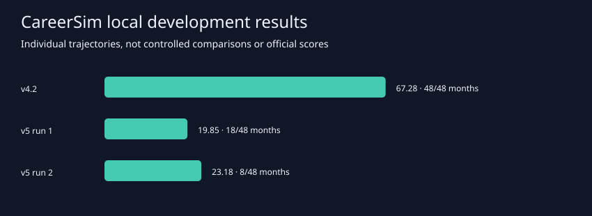

# TechArena CareerSim · Spärk AI

Versioned agent designs for the UK TechArena Career Simulation challenge. The agent makes workplace decisions across a 48-month career using the official MCP interface and the organiser-designated model.

## Explore the design

[Download and open the interactive presentation](docs/interactive/index.html). GitHub displays HTML as source; download the file and open it in a browser. This is the original v3 presentation, not a diagram of the later six-Skill design.

## Version history

| Version | Design |
| --- | --- |
| preliminary | Initial controller and quarterly planner |
| v3 | Two-Skill decision loop |
| v4 | Revised feedback and risk handling |
| v4.1 | Packaged policy revision |
| v4.2 | Risk follow-through |
| v4.3 | Follow-up revision |
| v5.0 | Adaptive policy rebuild |
| v5.1 | Evidence-based survival priorities |
| v6.0 | Six Skills with joint Energy and main-action allocation |

Each recovered snapshot is under `versions/`. Commit timestamps reflect publication of the archive, not original development dates. The preliminary folder preserves its original manifest.base.json. No separate v1/v2 submission artifacts were recovered; version labels have not been invented.

## Development results



| Local run | Quantitative score | Survival | Outcome |
| --- | ---: | ---: | --- |
| v4.2 | 67.28 | 48 months | Completed |
| v5.0, 20261030T130105Z | 19.85 | 18 months | Trust crisis |
| v5.0, 20261030T133256Z | 23.18 | 8 months | Financial distress |

These runs are separate trajectories. They do not establish a causal ranking of policies. No measured result is claimed here for v5.1 or v6.0. Earlier presentation labels may differ; the v4.2 attribution above follows the inspected loaded Skills and submission manifest. Official leaderboard scores combine evaluation components and must not be compared directly with these local quantitative scores.

## Latest architecture

v6.0 uses one agent with six Skills: session-state, choice-evaluation, survival-response, quarterly-portfolio, advancement-strategy and finish-and-score. Quarterly planning compares complete allocations across both Energy and the separate main action. Monthly decisions evaluate recurring commitments and practical consequences. Later versions are design candidates, not established performance improvements.

## Run a version

Use the official participation repository and its documented setup. Keep credentials in its local `.env`, outside this repository. With the official server running, point its runner to a selected snapshot:

```powershell
uv run python -m career_sim_runner play --submission "PATH/TO/versions/v6.0/solution"
```

The archived packages do not include the required presentation video. They are not complete final-submission ZIPs. Follow the current competition documentation when reproducing or submitting a design.

## Official competition references

- [Official participation repository](https://github.com/RAI-Internal/techarena-career-sim)
- [Official documentation](https://techarena-career-sim.readthedocs.io/en/latest/)
- [Competition rules](https://techarena-career-sim.readthedocs.io/en/latest/competition-rules.html)
- [Submission instructions](https://techarena-career-sim.readthedocs.io/en/latest/submission.html)

This is the team's project archive, not the official engine or an organiser-endorsed solution. Historical instructions describe the competition setup at development time.

## Maintaining the archive

Add new versions in new folders, record the actual model and loaded Skill version alongside results, and keep failed runs in aggregate reporting. Never commit API keys, `.env`, personal machine paths or unreviewed raw logs. Review changes in separate commits so each revision can be inspected and reverted.
